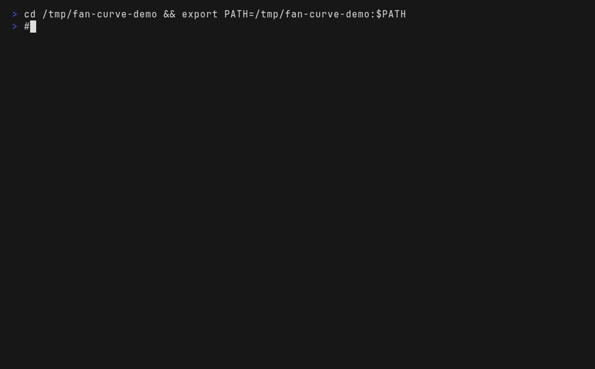

# Fan Curve

Fan Curve is a small macOS menu-bar app that adjusts fan speed from CPU temperature. It gives you a clear fan curve, live fan readings, and safe automatic recovery without a full hardware dashboard.



## Why

Fan control apps tend to be either whole hardware dashboards, with every sensor and voltage rail on screen, or a single "max fans" switch. Neither is what you want on a laptop you work on: you want the fans quiet at 45 C and ramp hard before the chip throttles, and you want to know the app will hand the fans back the moment anything goes wrong.

- **A curve, not a switch.** You set points on a temperature-to-percentage line, so "quiet until 60, then ramp to 90%" is one curve you can see. Scenes (Balanced, Quiet, Cooling) each carry their own curve, so switching to Quiet on battery is one click, not a redraw.
- **The safety rules are structural, not advice.** The helper clamps every target to the fan's own reported minimum and maximum, gives the fans back on quit, sleep, a lost heartbeat, or serious thermal pressure, and the app refuses to start control if the temperature or fan readings look wrong. See [Safety](#safety).
- **It tells you why it stopped.** Every control loss, with the heartbeat, fan modes, targets and thermal state at that moment, lands in a local log you can paste into an issue. That is the difference between "it didn't work" and a bug report someone can act on.

## Quickstart

```sh
brew install --cask jonathancostin/tap/fan-curve
fan-curve-helper install     # asks for your password once
open -a "Fan Curve"
```

Then: leave the default curve for the first test, turn on **Use fan curve**, check the menu says **Active** and each fan shows a live speed, and turn it off again to confirm the menu returns to **Automatic**. The full first-run walkthrough is under [First use](#first-use).

Not on Homebrew? [Build from source](#build-from-source) instead.

## How it works

Three pieces, one small program each:

1. **The app** (`FanCurveApp`, menu bar). Polls CPU temperature, evaluates the curve, applies the scene budget and smoothing, and writes a control state file. It never touches SMC hardware itself, so an unprivileged GUI process cannot leave the fans in a bad state.
2. **The helper** (`FanCurveHelper`, a root launchd job). Reads that state file, decides whether the request is still current (heartbeat, owner uid, the fan bounds the Mac actually reports), and only then sets fan mode and target RPM through the SMC. It writes back an acknowledgement the app checks before it shows **Active**. If the heartbeat goes stale it restores automatic control on its own, with no app involved.
3. **`fan-curve-curve`** (the curve engine on the command line). The same `FanCurveCore` code the app uses, with no GUI and no hardware: give it points, a scene ceiling and a fan RPM range and it prints what the app would ask for at each temperature. That is what the demo above records, and it is how the curve math is testable on a machine that isn't a Mac.

The order matters. The app asks, the helper verifies and acts, and the curve engine explains. Nothing in the path trusts a value it did not just read, and every part has a defined behavior when its input looks wrong: no curve control, no fan change, or an exit code and a message.

## Status

- Active. Distributed as a Homebrew cask from [jonathancostin/homebrew-tap](https://github.com/jonathancostin/homebrew-tap).
- Fully tested only on the two-fan Apple M5 Pro MacBook Pro (`Mac17,9`). See [Mac support](#mac-support).

## What you can do

- Set a fan curve by dragging points or entering exact values.
- Use named Balanced, Quiet, and Cooling scenes, each with its own curve.
- Set an optional per-scene fan ceiling and cooling priority.
- Opt in to power-aware scene switching: Quiet on battery, Balanced on AC or UPS power, with unknown power falling back to Balanced.
- See CPU temperature, current fan speed, target speed, and fan mode.
- Check recent temperature and fan output on the same chart.
- Copy a curve as JSON and paste it back later.
- Start the app at login.
- Choose whether to resume your curve after the app starts.
- Copy a private support report when a Mac needs testing.

`0%` uses each fan's safe minimum speed. `100%` uses its reported maximum speed.

## Safety

Fan Curve uses a small background helper for fan changes. You install it once with an administrator password; normal use does not ask again.

The app returns control to macOS when you:

- turn the curve off;
- quit the app;
- put the Mac to sleep;
- lose contact with the helper; or
- reach serious system heat pressure.

Fan targets always stay within the minimum and maximum speeds reported by the Mac. Scene budgets only cap or raise the requested percentage; they never bypass the helper's heartbeat, fan bounds, or thermal-pressure recovery. If temperature, fan, or helper data looks wrong, Fan Curve does not start control.

## Install with Homebrew

```sh
brew install --cask jonathancostin/tap/fan-curve
fan-curve-helper install
open -a "Fan Curve"
```

The helper command asks for an administrator password. After that, Fan Curve appears in the menu bar.

When Homebrew installs an update, update the helper too:

```sh
brew upgrade --cask fan-curve
fan-curve-helper install
```

## First use

1. Open Fan Curve from the Applications folder or with `open -a "Fan Curve"`.
2. Check the support label and detected fan count.
3. Leave the default curve in place for the first test.
4. Turn on **Use fan curve**.
5. Check that the menu says **Active** and that each fan shows a live speed.
6. Turn the curve off and make sure the menu returns to **Automatic**.

On a Mac that has known sensor keys but has not passed device tests, the app asks for a one-time confirmation before it enables control.

## Reading the menu

- **Active** — the helper has confirmed the curve and the fans are in forced mode.
- **Automatic** — macOS controls the fans.
- **Problem** — Fan Curve cannot confirm safe control or is still waiting for automatic control to return.

If you see **Problem**, turn the curve off. Use **Copy Support Report** if the problem remains.

## Control recorder

Fan Curve keeps a small local record of control changes and failures at:

```text
~/Library/Logs/Fan Curve/control-events.jsonl
```

Each loss records the state heartbeat, helper reply, fan modes and targets, CPU temperature, poll time, and system heat state. The file stops at 256 KB and keeps one older copy. It never leaves the Mac.

Read the latest events with:

```sh
tail -n 20 "$HOME/Library/Logs/Fan Curve/control-events.jsonl" | jq .
```

## Mac support

Fan Curve knows the CPU temperature keys used by Intel Macs and Apple M1 through M5 chips. It only works on Macs with physical fans.

Real fan changes and recovery have been fully tested on the two-fan Apple M5 Pro MacBook Pro (`Mac17,9`). Other Macs may show **Known keys** until someone completes the device test list. Intel Macs with more than two fans are not supported.

See [Device support](SUPPORT.md) for the current list and the safe test steps.

## Remove Fan Curve

Remove the helper before uninstalling the app:

```sh
fan-curve-helper uninstall
brew uninstall --cask fan-curve
```

## Curve engine on the command line

`fan-curve-curve` builds on macOS and Linux (it needs only `FanCurveCore`, no IOKit), so you can
check a curve without the app or a Mac:

```sh
swift build -c release --product fan-curve-curve
./.build/release/fan-curve-curve --points 40:10,60:50,80:90 --ceiling 45 --step 10
```

```
 temp(C)  curve%  budget%    rpm  note
      40      10       10   2600
      50      30       30   3800
      60      50       45   4700  capped
      70      70       45   4700  capped
      80      90       45   4700  capped

floor 10% at 40C, ceiling 90% at 80C, points valid: yes
```

`--range MIN:MAX` sets the fan RPM span (default `2000:8000`, the two-fan M5 Pro's). An invalid
curve prints `invalid curve:` and exits 2 rather than guessing, which is what makes it usable in a
test or a pre-commit check.

## Build from source

The SMC code lives in the `Vendor/Stats` Git submodule, so fetch it with the clone:

```sh
git clone --recurse-submodules https://github.com/8thlyr/fan-curve.git
cd fan-curve
```

In an existing clone, run `git submodule update --init --recursive` instead.

```sh
./scripts/build.sh
open build/FanCurve.app
./scripts/install-helper.sh
```

Run `./scripts/install-helper.sh uninstall` before deleting a source build. Developers should read [Development](DEVELOPING.md) before changing hardware support, helper behavior, or the release flow.

Requires Swift 6.1 (SwiftPM) and macOS 13 or later.

## Layout

- `Package.swift`: SwiftPM manifest. Library targets `StatsSMC` (IOKit SMC access), `FanCurveCore`, `FanCurveUI`; executables `FanCurveApp`, `FanCurveHelper`, `FanCurveProbe`, `FanCurveCheck`, `FanCurveAppCheck`, `fan-curve-curve`. Everything that needs IOKit or AppKit sits inside `#if os(macOS)`, so `FanCurveCore`, its tests and `fan-curve-curve` build on Linux.
- `Tests/FanCurveCoreTests/`: the Swift Testing suite (`swift test`).
- `Sources/`: one directory per target.
- `Resources/`: app `Info.plist` and the helper's launchd plist `com.jonathan.FanCurveHelper.plist`.
- `scripts/`: `build.sh` (builds and ad-hoc signs `build/FanCurve.app`), `install-helper.sh`, `install-local.sh`.
- `Vendor/Stats`: SMC reader and writer, Git submodule.
- `.github/workflows/`: `checks.yml` (pull requests), `release.yml` (pushes to `main` publish a release and update the Homebrew cask).
- [SUPPORT.md](SUPPORT.md), [DEVELOPING.md](DEVELOPING.md).

## Privacy and source

Fan Curve does not send fan or temperature data anywhere. Its support report leaves out serial numbers, account names, and hardware IDs.

The SMC reader and writer come from [Stats](https://github.com/exelban/stats) under the MIT license and stay pinned as a Git submodule.

## License

MIT. See [LICENSE](LICENSE). The vendored Stats code keeps its own MIT license.
